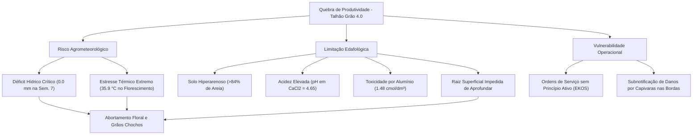
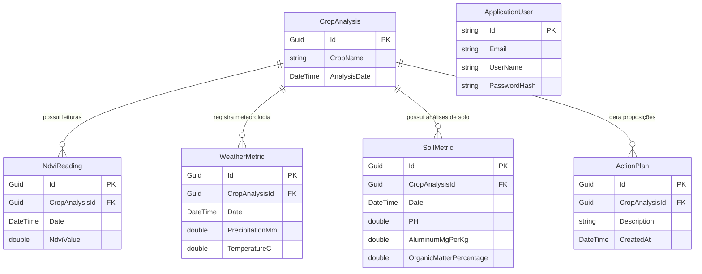

# 🌱 GeoMAC (FarmLab) — Análise Integrada de Quebra de Safra & Inteligência Agronômica

[](https://dotnet.microsoft.com/)
[](https://learn.microsoft.com/aspnet/core)
[](https://learn.microsoft.com/ef/core)
[](https://jwt.io/)
[](https://www.chartjs.org/)
[](LICENSE)

---

## 📌 Sumário
- [Visão Geral](#-visão-geral)
- [Contexto do Estudo de Caso (Safra 2025/2026)](#-contexto-do-estudo-de-caso-safra-20252026)
- [Diagnóstico Agronômico da Quebra de Safra](#-diagnóstico-agronômico-da-quebra-de-safra)
  - [1. Análise Espaço-Temporal de NDVI](#1-análise-espaço-temporal-de-ndvi)
  - [2. Fatores Limitantes & Matriz de Risco](#2-fatores-limitantes--matriz-de-risco)
  - [3. Proposições de Manejo (Plano de Ação)](#3-proposições-de-manejo-plano-de-ação)
- [Arquitetura de Software (.NET 10 Clean Architecture)](#-arquitetura-de-software-net-10-clean-architecture)
  - [Visão em Camadas](#visão-em-camadas)
  - [Diagrama da Arquitetura](#diagrama-da-arquitetura)
  - [Modelo de Dados (ERD)](#modelo-de-dados-erd)
- [Módulos e Interfaces (Frontends)](#-módulos-e-interfaces-frontends)
  - [1. Aplicação SPA Integrada (ASP.NET Core wwwroot)](#1-aplicação-spa-integrada-aspnet-core-wwwroot)
  - [2. Portal Estático Executivo (GitHub Pages)](#2-portal-estático-executivo-github-pages)
- [Bases de Dados Agronômicos Multissensoriais (`Base/`)](#-bases-de-dados-agronômicos-multissensoriais-base)
- [Endpoints da API RESTful](#-endpoints-da-api-restful)
- [Como Configurar e Executar](#-como-configurar-e-executar)
  - [Pré-requisitos](#pré-requisitos)
  - [Executando o Backend ASP.NET Core](#executando-o-backend-aspnet-core)
  - [Executando o Portal Estático](#executando-o-portal-estático)
- [Estrutura de Diretórios](#-estrutura-de-diretórios)
- [Tecnologias Empregadas](#-tecnologias-empregadas)
- [Autoria e Créditos](#-autoria-e-créditos)

---

## 📖 Visão Geral

O **GeoMAC (FarmLab)** é uma plataforma analítica e arquitetural voltada à **Inteligência Agronômica Espaço-Temporal** e à **Agricultura Digital de Precisão**. O projeto foi concebido para investigar, correlacionar e diagnosticar de forma exaustiva as causas raízes de **quebra de produtividade agrícola**, integrando dados heterogêneos de sensoriamento remoto (NDVI via satélite), telemetria veicular IoT de máquinas, atributos físico-químicos do solo e séries históricas agrometeorológicas.

O sistema é composto por:
1. **Núcleo Backend em .NET 10** estruturado sob os princípios de **Clean Architecture** e **Domain-Driven Design (DDD)**, com autenticação JWT, persistência em Entity Framework Core e banco SQLite.
2. **Dashboard Interativo & SPA** para visualização analítica com radar edafológico, gráficos combinados de estresse hídrico/térmico e curvas fenológicas de NDVI.
3. **Repositório de Dados Brutos e Processados (CSV e Parquet)** com centenas de milhares de telemetrias reais de campo da Fazenda Experimental da Universidade de Marília (Unimar).

---

## 🌾 Contexto do Estudo de Caso (Safra 2025/2026)

O estudo prático que fundamenta o projeto foi conduzido na área experimental da **Unimar Pesquisa** (Lat: `-22.2476`, Long: `-49.9764`), durante o ciclo produtivo de milho na safra **2025/2026**:

| Atributo | Detalhe |
| :--- | :--- |
| **Cultura** | Milho (*Zea mays*) |
| **Híbrido Utilizado** | DKB358PRO4 (Dekalb) |
| **Talhão Objeto** | **Grão 4.0** (19,3 hectares) |
| **Talhão Testemunha / Controle** | **Grão Convencional** (16,6 hectares) |
| **Data de Plantio** | 04 de Novembro de 2025 |
| **Data de Colheita** | 03 de Fevereiro de 2026 |
| **Estação Meteorológica** | Unimar Pesquisa (ID: `0020ED51`) |

Apesar da alta tecnologia empregada no talhão 4.0, observou-se uma queda acentuada de produtividade comparada ao talhão convencional, motivando o desenvolvimento desta auditoria analítica e da plataforma de software.

---

## 🔍 Diagnóstico Agronômico da Quebra de Safra

### 1. Análise Espaço-Temporal de NDVI
O acompanhamento do índice de vegetação por diferença normalizada (**NDVI**) obtido via satélite (OneSoil) permitiu traçar a dinâmica de biomassa e vigor vegetativo:
* **Fase Vegetativa Inicial (Nov/2025):** NDVI inicial de ~0,369 subindo consistentemente com o fechamento do dossel para 0,624.
* **Pico Vegetativo (16/Jan/2026):** O índice atingiu o ápice de **0,827** demonstrando elevado desenvolvimento de área foliar.
* **Colapso Reprodutivo (Fim de Jan/2026):** Queda drástica para **0,507** (redução de ~39%) antes da maturação fisiológica, caracterizando senescência precoce, abortamento foliar e falha de enchimento de grãos. No talhão convencional, o NDVI manteve-se sustentado em 0,710.

```
NDVI
1.0 ┤
    │                         * [16/Jan - Pico: 0.827]
0.8 ┤                   *---*   \
    │             *---*           \ [Colapso Rápido]
0.6 ┤       *---*                   \
    │ *---*                           * [31/Jan: 0.507]
0.4 ┤ [04/Nov: 0.369]                   * [03/Fev: 0.485 Colheita]
0.2 ┤
  0 └─────┬───────┬───────┬───────┬───────┬───────┬───────┬──────> Tempo
        04/Nov  24/Nov  17/Dez  27/Dez  01/Jan  16/Jan  31/Jan  03/Fev
```

---

### 2. Fatores Limitantes & Matriz de Risco

O diagnóstico técnico consolidado demonstrou que a quebra decorreu do efeito sinérgico negativo de três ordens de fatores:



#### A. Risco Agrometeorológico (Clima)
* **Déficit Hídrico no Pendoamento:** Precipitação nula (**0,0 mm**) na **Semana 7** (estádios VT/R1), momento mais sensível do milho para formação da espiga. Nas duas semanas críticas, o acumulado foi de apenas 16,8 mm.
* **Pico Térmico Extremo:** Temperatura máxima de **35,9 °C** durante a fase reprodutiva (Semana 8), provocando inviabilidade do pólen e dessecação dos estigmas.

#### B. Limitações Edafológicas (Solo)
* **Textura Arenosa:** Teor de areia superior a **84%** nas amostras críticas (Amostras 2 e 3 do laboratório Cropman), resultando em capacidade de retenção de água (CRA) muito baixa.
* **Barreira Química ao Sistema Radicular:** pH em $CaCl_2$ de **4,65** e presença deletéria de alumínio trocável ($Al^{3+}$) em **1,48 cmol/dm³** com saturação por bases baixa (47%). As raízes ficaram confinadas aos primeiros centímetros de solo, impedindo a absorção de água em horizontes mais profundos durante o veranico.

#### C. Vulnerabilidades Operacionais & Governança (Gestão)
* **Falta de Rastreabilidade Química:** Ordens de Serviço (OS) do sistema EKOS registraram apenas termos genéricos como "Inseticida+Foliar", sem indicação dos ingredientes ativos e doses aplicadas.
* **Omissão de Danos Bióticos:** Danos provocados por fauna silvestre (capivaras nas bordaduras) e focos secundários de pragas não foram apontados no módulo de armadilhas eletrônicas (*Traps*), impedindo ações mitigadoras tempestivas.

---

### 3. Proposições de Manejo (Plano de Ação)

| Prioridade | Eixo | Ação Recomendada | Justificativa Técnica |
| :--- | :--- | :--- | :--- |
| 🔴 **Alta** | **Edafológico** | **Correção a Taxa Variável (VRT)** | Aplicação localizada de calcário e gesso agrícola com base no histórico de NDVI e amostras 2 e 3, neutralizando o alumínio em subsuperfície para estimular o enraizamento profundo. |
| 🔴 **Alta** | **Física do Solo** | **Plantas de Cobertura na Entressafra** | Cultivo de *Urochloa* (Braquiária) para formação contínua de palhada, retenção de umidade e elevação gradual do teor de Matéria Orgânica nos pontos arenosos. |
| 🟡 **Média** | **Fitotécnico** | **Substituição de Híbrido** | O híbrido DKB358PRO4 sofreu alta penalidade pelo estresse ambiental. Recomenda-se migrar para materiais de maior estabilidade fenotípica e tolerância à seca. |
| 🟡 **Média** | **Infraestrutura**| **Irrigação de Resgate** | Avaliação técnico-financeira para implantação de pivô ou sistema suplementar acionado em estádios fenológicos reprodutivos críticos. |
| 🟢 **Operacional**| **Governança** | **Auditoria de Apontamentos (EKOS)** | Condicionar o fechamento de OS ao preenchimento obrigatório de lote, molécula ativa e dosagem de defensivos, além de registro diário de armadilhas. |
| 🟢 **Operacional**| **Fitossanitário**| **Controle de Fauna** | Instalação de barreiras físicas e cercamento elétrico nas divisas limítrofes para conter a invasão de capivaras. |

---

## 🏗️ Arquitetura de Software (.NET 10 Clean Architecture)

O backend do GeoMAC foi implementado em **.NET 10 (C# 13)**, estruturado segundo as boas práticas de **Clean Architecture**, desacoplamento por inversão de dependência e separação de responsabilidades em camadas.

### Visão em Camadas

```
GeoMac/
├── GeoMac.Domain/            # Camada Central (Entidades, Interfaces de Repositório, Regras)
├── GeoMac.Application/       # Casos de Uso (Services, DTOs, Mapeamentos)
├── GeoMac.Infrastructure/    # Acesso a Dados (EF Core, Migrações, DbContext, Identity, SQLite)
└── GeoMac.Presentation/      # Interface de Entrada (ASP.NET Core Web API, Controllers, JWT, SPA)
```

1. **`GeoMac.Domain`**: Não possui dependência de frameworks externos de infraestrutura.
   - Entidades: `CropAnalysis`, `NdviReading`, `WeatherMetric`, `SoilMetric`, `ActionPlan`, `ApplicationUser`.
   - Interfaces: `IRepository<T>` (abstração de repositório genérico assíncrono).
   - Exceções de Domínio: `DomainException`.

2. **`GeoMac.Application`**:
   - DTOs: `LoginDto`, `RegisterDto`, `DashboardDto`.
   - Serviços: `IDashboardService` e implementação `DashboardService`.
   - Injeção de dependência via método de extensão `AddApplication()`.

3. **`GeoMac.Infrastructure`**:
   - `GeoMacDbContext`: Herda de `IdentityDbContext<ApplicationUser>`, mapeando as tabelas e relacionamentos.
   - `EfRepository<T>`: Implementação de repositório assíncrono com EF Core.
   - Migrações: Gerenciamento do esquema do banco de dados SQLite (`geomac.db`).
   - Injeção de dependência via método de extensão `AddInfrastructure()`.

4. **`GeoMac.Presentation`**:
   - Web API RESTful com Swagger/OpenAPI.
   - Autenticação e Autorização via tokens JWT (`JwtBearer`).
   - Servidor de arquivos estáticos (`UseDefaultFiles`, `UseStaticFiles`) hospedando a interface SPA moderna em `wwwroot/`.
   - Política de CORS configurada (`AllowAll`).

---

### Diagrama da Arquitetura

```mermaid
graph TD
    subgraph Presentation ["GeoMac.Presentation (ASP.NET Core Web API)"]
        AC[AuthController]
        DC[DashboardController]
        SPA["SPA Frontend (HTML5/CSS3/JS)"]
    end

    subgraph Application ["GeoMac.Application"]
        DS[DashboardService]
        DTO[DashboardDto / AuthDTOs]
        IDS[IDashboardService]
    end

    subgraph Domain ["GeoMac.Domain"]
        CA[CropAnalysis]
        NR[NdviReading]
        WM[WeatherMetric]
        SM[SoilMetric]
        AP[ActionPlan]
        IR[IRepository&lt;T&gt;]
    end

    subgraph Infrastructure ["GeoMac.Infrastructure"]
        DBC[(GeoMacDbContext / SQLite)]
        EFR[EfRepository&lt;T&gt;]
        IDT[ASP.NET Core Identity]
    end

    SPA -->|Requisições HTTP / JSON| AC & DC
    DC --> IDS
    DS -.->|Implementa| IDS
    DS --> DTO
    DS --> IR
    EFR -.->|Implementa| IR
    EFR --> DBC
    AC --> IDT
    IDT --> DBC
    CA *-- NR
    CA *-- WM
    CA *-- SM
    CA *-- AP
```

---

### Modelo de Dados (ERD)



---

## 💻 Módulos e Interfaces (Frontends)

O projeto conta com duas experiências de frontend integradas:

### 1. Aplicação SPA Integrada (ASP.NET Core `wwwroot`)
Localizada em `GeoMac.Presentation/wwwroot`, é servida diretamente pelo servidor ASP.NET Core:
* **Tela de Login / Registro (`index.html`)**: Autenticação moderna com efeitos visuais em CSS Glassmorphism, validação assíncrona contra `/api/auth/login` e `/api/auth/register`, e armazenamento seguro de token JWT no `localStorage`.
* **Painel de Controle (`dashboard.html`)**: Dashboard estruturado com menu lateral responsivo, cartões com KPIs com indicadores de criticidade, seções segmentadas para Visão Geral, Análise de NDVI, Dados Climáticos, Diagnóstico Edafológico e Planos de Ação.

### 2. Portal Estático Executivo (GitHub Pages)
Localizado na raiz (`index.html`, `app.js`, `style.css`), foi projetado para apresentação direta e publicação via GitHub Pages (`geomac.gitgub.io`):
* Utiliza **Chart.js 4** com plugins de anotação.
* Gráfico de Linha Comparativo de NDVI com demarcação da onda de calor.
* Gráfico de Radar dos atributos químicos do solo (Zona Saudável vs. Problemática).
* Gráfico Misto (Barras + Linhas) para Precipitação e Temperatura Máxima.
* Animações de rolagem com *Intersection Observer*.

---

## 📊 Bases de Dados Agronômicos Multissensoriais (`Base/`)

O diretório `Base/` abriga os conjuntos de dados brutos e estruturados coletados ao longo de todo o ciclo da safra 2025/2026, disponibilizados tanto em formato tabular legível (**CSV**) quanto em formato colunar otimizado para Big Data (**Parquet**):

```
Base/
├── Cropman - Análise de solo/
│   ├── CSV/soil_analysis.csv
│   └── PARQUET/soil_analysis.parquet
├── EKOS - Telemetria e Armadilhas Eletrônicas/
│   ├── CSV/
│   │   ├── Fields/ (Polígonos espaciais WKT dos talhões)
│   │   ├── Implements/ (Implementos agrícolas cadastrados)
│   │   ├── Inputs/ (Insumos e fertilizantes)
│   │   ├── Layers/ (Camadas de RPM, Temperatura, Combustível, Sobreposição, etc.)
│   │   ├── Machines/ & Operators/ (Frota de tratores, colhedoras e operadores)
│   │   ├── Os/ (Ordens de serviço de calagem, plantio, pulverização e colheita)
│   │   ├── Pest/ (Monitoramento de pragas e capturas em armadilhas)
│   │   └── Stopreasons/ (Apontamentos de motivos de paradas de máquinas)
│   └── PARQUET/ (Versões binárias colunares de todas as camadas acima)
├── Metos - Estação Meteorológica/
│   ├── CSV/Relatório Horário de 01-11-2025 - 25-02-2026 - GMT - 03h00.csv
│   └── PARQUET/Relatório Horário de 01-11-2025 - 25-02-2026 - GMT - 03h00.parquet
└── OneSoil - Imagens de Satélite/
    ├── CSV/ndvi_metadata.csv (Metadados das cenas, nuvens, resolução e estatísticas zonais)
    ├── PARQUET/ndvi_metadata.parquet
    └── JPG/ (Mosaicos de imagens NDVI ao longo do ciclo)
```

---

## 🔌 Endpoints da API RESTful

A API do GeoMAC expõe os seguintes serviços:

| Método | Endpoint | Protegido | Descrição |
| :--- | :--- | :---: | :--- |
| `POST` | `/api/auth/register` | Não | Registra um novo usuário na base Identity. |
| `POST` | `/api/auth/login` | Não | Valida credenciais e retorna o token JWT assinado. |
| `GET` | `/api/dashboard/{cropAnalysisId}` | Opcional | Retorna os dados consolidados de NDVI, clima e solo para o talhão selecionado. |
| `GET` | `/swagger` | Não | Documentação interativa OpenAPI/Swagger (modo Development). |

### Exemplo de Payload de Resposta (`GET /api/dashboard/{id}`)
```json
{
  "labels": ["Jan", "Fev", "Mar", "Abr", "Mai"],
  "ndviValues": [0.2, 0.4, 0.6, 0.8, 0.7],
  "precipitations": [120.5, 90.0, 150.2, 80.5, 60.0],
  "temperatures": [22.5, 24.0, 23.5, 20.0, 18.5]
}
```

---

## 🚀 Como Configurar e Executar

### Pré-requisitos
* [.NET 10 SDK](https://dotnet.microsoft.com/) instalado.
* Navegador moderno (Chrome, Firefox, Edge, Safari).
* Opcional: Extensão *C# Dev Kit* no VS Code ou Visual Studio 2022/2026.

---

### Executando o Backend ASP.NET Core

1. **Clone o repositório:**
   ```bash
   git clone https://github.com/seu-usuario/GeoMAC.git
   cd GeoMAC
   ```

2. **Restaure as dependências e compile a solução:**
   ```bash
   dotnet restore
   dotnet build
   ```

3. **Inicie o servidor de desenvolvimento:**
   ```bash
   dotnet run --project GeoMac.Presentation
   ```

4. **Acesse as interfaces:**
   * **Swagger UI:** `http://localhost:5000/swagger` ou `https://localhost:5001/swagger`
   * **Página de Login do Sistema:** `http://localhost:5000/` ou `http://localhost:5000/index.html`
   * **Dashboard Interno:** `http://localhost:5000/dashboard.html`

---

### Executando o Portal Estático

Caso queira executar apenas a página executiva estática contida na raiz do repositório:

* **Via Python:**
  ```bash
  python -m http.server 8080
  ```
  Acesse no navegador: `http://localhost:8080`

* **Via Node.js (npx):**
  ```bash
  npx serve .
  ```

* **Via VS Code:**
  Abra a pasta do projeto e utilize a extensão **Live Server** clicando com o botão direito em `index.html` -> *Open with Live Server*.

---

## 📁 Estrutura de Diretórios

```
GeoMAC/
├── .gitignore                                 # Configuração de exclusões do Git
├── app.js                                     # Lógica e dados dos gráficos do portal executivo
├── CNAME                                      # Domínio customizado para GitHub Pages
├── GeoMac.sln                                 # Solução global .NET
├── index.html                                 # Página inicial / Relatório Executivo Estático
├── README.md                                  # Documentação completa do projeto
├── style.css                                  # Estilos responsivos do portal executivo
│
├── GeoMac.Domain/                             # Camada de Domínio (DDD)
│   ├── Entities/                              # Entidades: CropAnalysis, NdviReading, etc.
│   ├── Exceptions/                            # Exceções de negócio
│   └── Interfaces/                            # IRepository<T>
│
├── GeoMac.Application/                        # Camada de Aplicação
│   ├── DTOs/                                  # LoginDto, RegisterDto, DashboardDto
│   └── Services/                              # DashboardService, IDashboardService
│
├── GeoMac.Infrastructure/                     # Camada de Infraestrutura
│   ├── Data/                                  # GeoMacDbContext, migrações EF Core
│   └── Repositories/                          # EfRepository<T>
│
├── GeoMac.Presentation/                       # Camada de Apresentação (API & Web)
│   ├── Controllers/                           # AuthController, DashboardController
│   ├── Properties/                            # launchSettings.json
│   ├── appsettings.json                       # Configurações de conexão SQLite e JWT
│   └── wwwroot/                               # Aplicação SPA
│       ├── css/                               # Estilos globais, login e dashboard
│       ├── js/                                # login.js
│       ├── index.html                         # Tela de autenticação / login
│       └── dashboard.html                     # Painel completo do usuário
│
└── Base/                                      # Conjunto de Dados Agronômicos Reais
    ├── Cropman - Análise de solo/             # Amálises laboratoriais físico-químicas
    ├── EKOS - Telemetria e Armadilhas/        # Dados de telemetria, OS e armadilhas
    ├── Metos - Estação Meteorológica/         # Leituras climáticas horárias Unimar
    ├── OneSoil - Imagens de Satélite/         # Metadados e imagens raster NDVI
    └── site/                                  # Backup do portal executivo
```

---

## 🛠️ Tecnologias Empregadas

* **Linguagens & Runtimes:** C# (.NET 10), JavaScript (ES6+), HTML5, CSS3 Moderno, SQL.
* **Frameworks Backend:** ASP.NET Core Web API, Entity Framework Core 10, ASP.NET Core Identity.
* **Segurança:** Autenticação baseada em Tokens JWT (*HMAC-SHA256*), Hash seguro de senhas com Identity.
* **Banco de Dados:** SQLite (`geomac.db`).
* **Visualização de Dados:** Chart.js, Chart.js Plugin Annotation, FontAwesome 6.
* **Engenharia de Dados:** Apache Parquet, CSV, Geometrias espaciais WKT (Well-Known Text).
* **Sensoriamento & IoT Agrícola:** Metos Pessl Instruments, EKOS Field Management, OneSoil Satellite Analytics, Cropman Soil Labs.

---

## 👥 Autoria e Créditos

Projeto desenvolvido como parte dos estudos e iniciativas de pesquisa em **Agricultura Digital e Análise Espaço-Temporal de Produtividade** no âmbito do **FarmLab** e da **Universidade de Marília (Unimar)**.

* **Instituição:** Universidade de Marília (Unimar)
* **Talhão Analisado:** Grão 4.0 (19,3 ha) vs. Grão Convencional (16,6 ha)
* **Safra:** 2025/2026
* **Mantenedor do Repositório:** Cauã Dias e colaboradores do FarmLab / GeoMAC.
